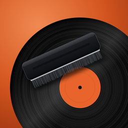
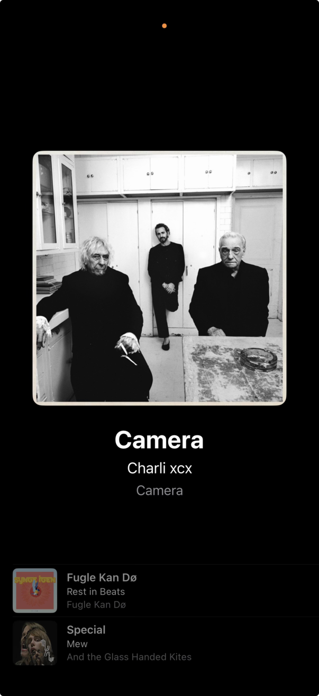
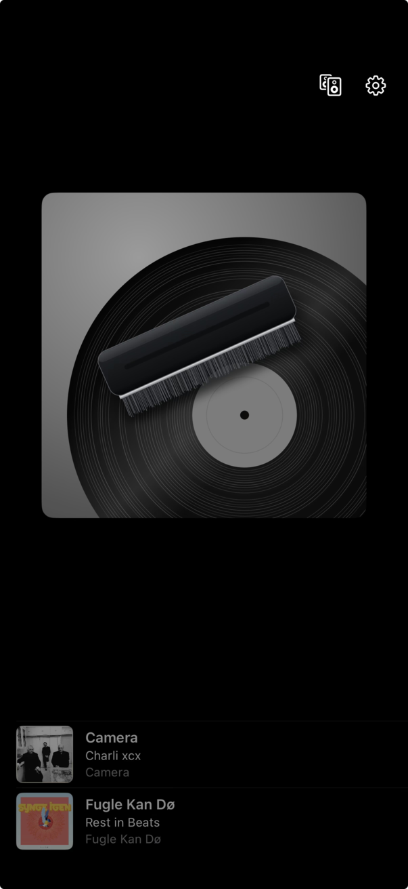
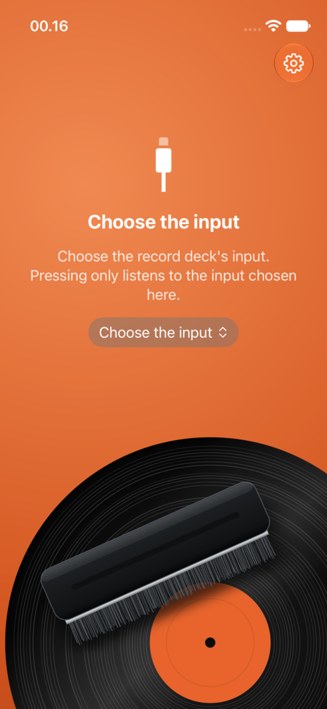
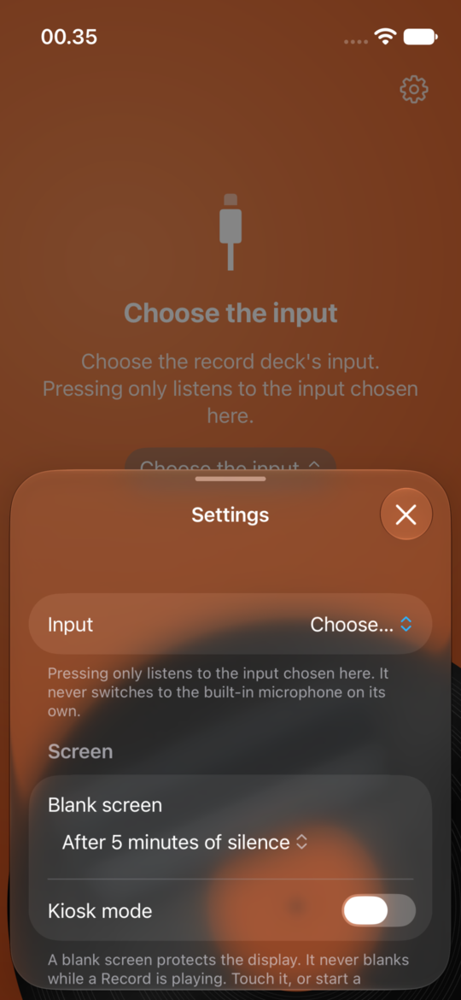
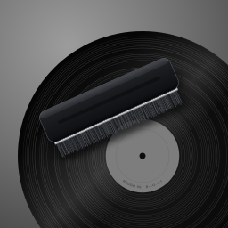

<p align="center">
  
</p>

<h1 align="center">Pressing</h1>

<p align="center">An iPhone bridge from your record deck to Sonos speakers.</p>

Pressing turns a spare iPhone into a dedicated turntable companion. Put a pressing on the deck, and the phone streams it to the Sonos Rooms you've chosen. It also shows what's playing and keeps a history, and it can scrobble every Track to Last.fm. You don't have to touch the phone.

<p align="center">
  
  &nbsp;
  
  &nbsp;
  
  &nbsp;
  
</p>
<p align="center"><sub>Now Playing on an iPhone in kiosk mode, with a Track and before one is identified; the start screen and Settings, from the simulator.</sub></p>

> **Status:** a personal project, in daily use. The code is covered by about 200 tests, and the first full test pass on an iPhone with a USB deck and Sonos speakers is complete ([#10](https://github.com/steffentchr/Pressing/issues/10)). Expect the occasional rough edge.

## What it does

- **Starts by itself.** Drop the needle and a Session starts. When the side runs out, Pressing waits through the Flip. If no new Record starts, it stops the speakers after 45 s of silence, even with the stylus still in the run-out groove.
- **Plays in your Sonos Rooms.** Tick any number of Rooms, each with its own volume, and they play in sync. Pressing takes them over even if they were playing something else. If someone takes a Room back in the Sonos app, Pressing steps back and leaves it alone until the next Session.
- **Plays on the phone too, if you like.** "This iPhone" plays the Record on the phone's speaker, Bluetooth earphones or an AirPlay receiver, a few seconds ahead of the Rooms.
- **Knows what's playing.** ShazamKit identifies each Track. Now Playing shows the cover, title, artist and album. The Sonos app shows "Artist – Title" under the station name "Pressing".
- **Keeps a history.** The Tracks you've played sit under Now Playing, newest first, each Track once. Tap one to look it up on Spotify.
- **Scrobbles to Last.fm.** It sends "now playing" and scrobbles each Track once it qualifies. Scrobbles queue up while offline.
- **Behaves like an appliance.** The screen never blanks while a Record plays. It blanks after a set time of silence to protect the OLED panel. Kiosk mode hides the status bar, and hides the on-screen icons until you touch the screen.

## How it works

```
turntable ─► USB (deck with built-in preamp, or preamp + USB audio interface)
          ─► Lightning/USB-C camera adapter with charging ─► iPhone running Pressing
                                                               │
              ┌────────────────────────────────────────────────┼─────────────────────┐
              ▼                                                ▼                     ▼
   live 320 kbps MP3 stream on the phone              ShazamKit identifies     Last.fm scrobbles
   ─► Sonos Rooms, controlled over the LAN            the Track
```

- **Detection.** Pressing watches the input level and detects Records, Gaps between tracks, Flips and Sessions. It uses a median that ignores the clicks of the run-out groove. The settings are described in [Calibrate detection](#calibrate-detection).
- **Sonos.** Pressing controls the speakers over Sonos's local UPnP interface, not the cloud API ([ADR 0001](docs/adr/0001-local-upnp-for-sonos-control.md)). It finds them with Bonjour ([ADR 0003](docs/adr/0003-bonjour-discovery.md)). Each Room plays the phone's own live MP3 stream ([ADR 0002](docs/adr/0002-live-mp3-stream.md)), encoded with LAME. A few seconds of Sonos buffering is expected.
- **Vocabulary.** Words like Record, Gap, Flip, Session, Track, Play, Room, Takeover and Step back have exact meanings, defined in [GLOSSARY.md](GLOSSARY.md).

## What you need

- **An iPhone on iOS 17 or later** that can stay beside the deck, plugged in. It was designed on an iPhone 12 mini.
- **A turntable with USB audio.** Either a deck with a USB output, such as the Numark TT USB, or a phono preamp feeding a class-compliant USB audio interface.
- **A camera adapter with a charging port**, so the phone charges while the deck is plugged in. On Lightning phones that's Apple's Lightning to USB 3 Camera Adapter.
- **Sonos speakers** on the same Wi-Fi network as the phone.
- **A Mac with Xcode** (current release) and [XcodeGen](https://github.com/yonaskolb/XcodeGen).
- **An Apple Developer Program membership.** You install Pressing from source onto your own phone, and the ShazamKit App Service is enabled per App ID in the developer portal. This guide assumes a paid membership.
- **Optional: a Last.fm account**, if you want scrobbling.

## Install it on your iPhone

Pressing isn't on the App Store. You build it from source and install it on your own phone.

1. **Clone the repository and install XcodeGen.**

   ```sh
   git clone https://github.com/steffentchr/Pressing.git
   cd Pressing
   brew install xcodegen
   ```

2. **Set your bundle ID and team.** Copy the example and fill in both values:

   ```sh
   cp Config/Signing.xcconfig.example Config/Signing.xcconfig
   ```

   - `PRESSING_BUNDLE_ID` is a bundle ID you make up. It must be unique, and in reverse-domain form, for example `com.yourname.pressing`.
   - `PRESSING_DEVELOPMENT_TEAM` is your 10-character team ID. Find it in Xcode › Settings › Accounts, or under Membership details at [developer.apple.com/account](https://developer.apple.com/account).

   The copy is git-ignored.

3. **Optional: add a Last.fm API account.** This step is only for scrobbling.
   1. Create an API account at [last.fm/api/account/create](https://www.last.fm/api/account/create). The callback URL can stay empty.
   2. Copy the example config:

      ```sh
      cp Config/LastFm.xcconfig.example Config/LastFm.xcconfig
      ```

   3. Fill in the API key and shared secret from [last.fm/api/accounts](https://www.last.fm/api/accounts).

   Without this file, the app still builds, and Settings says Last.fm isn't available. The secret ends up inside the built app, so keep your builds to your own devices.

4. **Generate the Xcode project.**

   ```sh
   xcodegen generate
   ```

   The first run also builds the MP3 encoder, which takes about a minute and needs the network once. `scripts/build-lame.sh` downloads LAME 3.100, checks its SHA-256, and builds `Vendor/LAME.xcframework`, which is git-ignored. Run `xcodegen generate` again whenever you pull changes, because the `.xcodeproj` isn't checked in.

5. **Register the App ID with ShazamKit.** Without this step, nothing is identified.
   1. At [developer.apple.com/account](https://developer.apple.com/account), open **Certificates, IDs & Profiles**, then **Identifiers**, and click **+**.
   2. Choose **App IDs**, then **App**.
   3. Enter an **Explicit** bundle ID: the one from step 2.
   4. On the **App Services** tab, tick **ShazamKit** and register.

   Do this yourself. Xcode's automatic signing usually installs Pressing under the team's wildcard profile, so it never creates an App ID you could add the service to. Apple's guide is [Enable ShazamKit for an App ID](https://developer.apple.com/help/account/configure-app-services/shazamkit).

6. **Install on the phone.**
   1. Open `Pressing.xcodeproj`, connect the iPhone and choose it as the run destination.
   2. Run (⌘R).
   3. On first install, iOS asks you to turn on **Developer Mode** (Settings › Privacy & Security). Turn it on and run again.

7. **First launch.**
   1. Plug the deck into the phone.
   2. Choose the deck's input on the start screen, allowing the microphone when asked. Pressing only ever listens to the input you choose.
   3. Allow **local network** access when asked. Pressing then finds your Sonos Rooms.
   4. Tap the speaker icon and tick the Rooms that should play.
   5. [Calibrate detection](#calibrate-detection) once for your deck.
   6. For a dedicated phone, tick **Kiosk mode** in Settings › Screen, and start **Guided Access** (Settings › Accessibility) so nobody can leave the app.

## Using Pressing

Pressing shows one screen at a time:

- **Start screen.** It asks for the input until one is chosen, and again whenever the chosen input is unplugged. Once the input is ready, it reads "Put on a pressing to start." with the input's name under it. Tap the name to switch inputs.
- **Now Playing.** This appears by itself when a Record starts and stays through Gaps and Flips. It shows the current Track large. Until a Track is identified, the grey version of the app's artwork holds its place. History sits below, with the two latest Tracks at rest; scroll down for up to 50.

Two icons sit in the top right:
- **The speaker** opens the Rooms sheet. Tick a Room to switch it on at once, and a volume bar appears. The sheet also shows Rooms that can't be reached or that Pressing stepped back from. "This iPhone" at the top plays on the phone's own output; once it's ticked, its AirPlay button chooses where.
- **The gear** opens Settings: the input, screen blanking, kiosk mode and Last.fm, with Detection and Permissions in submenus.

### Identification and Last.fm

Pressing searches for the Track at the start of a Record, after each Gap, and every 30 s otherwise. Keep the deck's pitch at zero, or Tracks won't match.

Connect Last.fm in Settings. Pressing opens Last.fm's own sign-in page, so it never sees your password, and keeps the session key in the Keychain. If the page doesn't close by itself after you approve Pressing, close it, and Pressing finishes connecting.

Rules for scrobbling:
- **When a Track counts:** it must be longer than 30 s and have played for half its length or 4 minutes, whichever is less. If Last.fm doesn't know the length, it counts at 4 minutes, or at its end if it ran at least 30 s.
- **Offline:** Plays waiting for Last.fm survive a restart and are retried as soon as the network returns.
- **While not connected:** Plays made while Last.fm isn't connected are never sent later.

Shazam doesn't give album names, so the album comes from Last.fm when it's connected.

### Calibrate detection

A Record starts when the level stays above the threshold for the start delay. It ends with a Flip once the level stays below the threshold for the Flip threshold. Calibrate once per deck and gain setting:

1. Set the deck's USB gain so loud passages peak well below clipping. On the Numark TT USB, the gain and phono/line switches are on the underside.
2. Keep pitch at zero.
3. Play a Record through to the run-out groove and leave the stylus there with the platter turning.
4. In Settings › Detection, read the noise floor (white tick). Set the threshold (orange tick) clearly above it but below the quietest music.

Changing the gain means calibrating again. If the noise floor is high because of hum, try another charger or socket first, since the deck and the phone's charger can form a ground loop.

The defaults are a start threshold of −50 dBFS, a 1.5 s start delay, a 12 s Flip threshold, and a 45 s stop delay. The stop delay counts from when the silence began, and it must be longer than the Flip threshold.

## Pressing Menu on your Mac

**Pressing Menu** is a menu-bar app for a Mac (macOS 26 or later) on the same network as the phone. It shows what Pressing is playing without getting up. It finds Pressing on the iPhone by itself over Bonjour and talks to it over a WebSocket, with no pairing ([ADR 0004](docs/adr/0004-pressing-menu-link.md)). The iPhone stays in charge: Pressing Menu only shows Pressing's state and sends the same intents as the phone's own controls. Pressing must be running on the phone, in front or in kiosk mode.

- **The menu-bar icon** is a stylised record. It's dashed while no phone is connected, and fills in while a Record plays. Click it to open the panel.
- **The panel** shows the current Track large, with the artist beneath and the album once Last.fm names it, or what Pressing is doing, with the last 10 Tracks below. After a Flip it says "Between sides", with the last Track's title beneath, until the next Record starts or the Session ends. While no phone is connected, it says only "Looking for Pressing on your iPhone…", small. If the link drops, the last Track and History stay on screen, greyed, with that line beneath the Track, while Pressing Menu keeps reconnecting.
- **Click a Track** in the panel, in the header or in History, to search for it in Spotify or Apple Music, whichever Settings names. There is no menu.
- **Notifications** announce each new Track identified while connected, with its cover. Clicking one opens the panel. There's none for the Track already playing when Pressing Menu connects, and none while the panel is open.
- **The footer:** the power button quits Pressing Menu and leaves Pressing on the phone alone. The gear opens Settings: Appearance, Launch at login, Notify on new Track, and Find songs in. Both stay usable while no phone is connected. On the right, while a phone is connected, the Rooms summary shows where Pressing plays, and opens the Rooms view in place of History: This iPhone and every Sonos Room, ticked on or off at once, with a volume slider for each Room that's on.

## Artwork

<p>
  
  &nbsp;
  
</p>

The artwork shows a vinyl record with an orange label, and a record-cleaning brush resting on it, against a warm orange gradient. The SVG sources are in [`Design/`](Design):

| Source | Used as |
|---|---|
| [`Design/AppIcon.svg`](Design/AppIcon.svg) | The app icon. |
| [`Design/StartScreen.svg`](Design/StartScreen.svg) | The start screen and the launch screen: the icon's artwork with the orange extended upwards and the record anchored at the bottom. It's sized at 450 × 972 pt, so it covers every iPhone. Its label, unlike the icon's, carries a faint catalogue number, "ROUGH 96 B-1U-1-1". The launch screen shows it at the same size and position, so the app opens without a jump. |
| [`Design/NoTrackCover.svg`](Design/NoTrackCover.svg) | The cover on Now Playing while no Track is identified: the icon in grey, with the start screen's catalogue number on its label. |

The PNGs in `App/Resources/Assets.xcassets` are rendered from these files and are opaque, as iOS requires. After editing an SVG, re-render with `rsvg-convert` and ImageMagick (`brew install librsvg imagemagick`):

```sh
rsvg-convert -w 1024 -h 1024 Design/AppIcon.svg | magick - -alpha remove -alpha off \
  App/Resources/Assets.xcassets/AppIcon.appiconset/AppIcon-1024.png
rsvg-convert Design/StartScreen.svg | magick - -alpha remove -alpha off \
  App/Resources/Assets.xcassets/StartScreen.imageset/StartScreen@3x.png
rsvg-convert -w 960 -h 960 Design/NoTrackCover.svg | magick - -alpha remove -alpha off \
  App/Resources/Assets.xcassets/NoTrackCover.imageset/NoTrackCover@3x.png
```

`Design/StartScreen.svg` and `Design/NoTrackCover.svg` are derived from the icon. If the icon changes, regenerate them too, and keep the catalogue number on their labels but off the icon's.

Pressing Menu's artwork has its own sources, rendered into `Menu/Resources/Assets.xcassets`:

| Source | Used as |
|---|---|
| [`Design/MenuAppIcon.svg`](Design/MenuAppIcon.svg) | Pressing Menu's Mac app icon: the app icon inside the macOS icon grid, an 824 × 824 rounded square on a transparent 1024 canvas. It's derived from `AppIcon.svg`; the comment in it says how. |
| [`Design/MenuBarIcon.svg`](Design/MenuBarIcon.svg) | The menu-bar icon while connected: a stylised record (rim, one groove, label and spindle hole) as an 18 pt template image, black on transparent, which macOS tints. No brush. |
| [`Design/MenuBarIconPlaying.svg`](Design/MenuBarIconPlaying.svg) | The menu-bar icon while a Record plays: the record filled in. |
| [`Design/MenuBarIconUnreachable.svg`](Design/MenuBarIconUnreachable.svg) | The menu-bar icon while no phone is connected: the rim dashed and the label hollow. |

Mac icons keep their transparency. Re-render all of them with:

```sh
scripts/render-menu-artwork.sh
```

## Development

```
App/            SwiftUI shell and the production adapters (AVAudioSession, Bonjour, ShazamKit, …)
Menu/           Pressing Menu, the Mac menu-bar app: SwiftUI panel and Settings, and its adapters (Bonjour/WebSocket link, notifications, login item)
PressingCore/   All behaviour, and Pressing Menu's model, as a Swift package with no UIKit or SwiftUI; see its README
Config/         xcconfig files: shared settings, plus examples for your signing and Last.fm keys
Design/         SVG sources for the icon and artwork
docs/adr/       Architecture decisions
docs/agents/    How coding agents use the issue tracker, labels and domain docs
scripts/        build-lame.sh, render-menu-artwork.sh
GLOSSARY.md     The domain vocabulary
project.yml     XcodeGen project definition
```

Run the tests. They run on macOS and need no simulator:

```sh
swift test --package-path PressingCore
```

Build the app for the simulator:

```sh
xcodegen generate
xcodebuild -project Pressing.xcodeproj -scheme Pressing \
  -destination 'generic/platform=iOS Simulator' build CODE_SIGNING_ALLOWED=NO
```

Build Pressing Menu, the Mac app (macOS 26 and later). It doesn't use LAME:

```sh
xcodebuild -project Pressing.xcodeproj -scheme PressingMenu \
  -destination 'generic/platform=macOS' build CODE_SIGNING_ALLOWED=NO
```

Its bundle ID is the iPhone app's with `.menu` appended.

**Where tests go.** Behaviour is tested through PressingCore's public interface, with fakes for every connection to the outside world: audio input, Sonos, recogniser, Last.fm, clock, storage, stream and phone output. The app's adapters and SwiftUI views are checked by hand on a device.

**Specs and work.** Specs and tickets are GitHub issues. The original spec is [#1](https://github.com/steffentchr/Pressing/issues/1), and the first on-device checklist is [#10](https://github.com/steffentchr/Pressing/issues/10); it's a good template for checking a new build on the phone.

### Xcode Cloud and TestFlight

Xcode Cloud can build Pressing and send it to TestFlight. Because the `.xcodeproj` and both xcconfigs are git-ignored, [`ci_scripts/ci_post_clone.sh`](ci_scripts/ci_post_clone.sh) recreates them right after Xcode Cloud clones the repo. It writes the xcconfigs from the workflow's environment, installs XcodeGen and runs `xcodegen generate`, which also builds LAME. Set these in the workflow's **Environment** section:

| Variable | Value |
|---|---|
| `PRESSING_BUNDLE_ID` | The app's bundle ID, as registered in App Store Connect |
| `PRESSING_DEVELOPMENT_TEAM` | The 10-character team ID |
| `PRESSING_LASTFM_API_KEY` | Last.fm API key. Mark it **Secret**. Optional. |
| `PRESSING_LASTFM_API_SECRET` | Last.fm shared secret. Mark it **Secret**. Optional. |

### Releasing Pressing Menu

Pressing Menu ships on the Mac App Store, apart from the iPhone app. The two can be out of step, because the wire contract only ever adds fields ([ADR 0004](docs/adr/0004-pressing-menu-link.md)).

- **Sandbox.** [`Menu/PressingMenu.entitlements`](Menu/PressingMenu.entitlements) turns on the App Sandbox with outgoing network connections only. [`Menu/Info.plist`](Menu/Info.plist) declares `_pressing._tcp`, and `project.yml` sets the local network usage description. Launch at login uses `SMAppService`, which works in the sandbox.
- **Version and build** are `MARKETING_VERSION` and `CURRENT_PROJECT_VERSION` under the `PressingMenu` target in `project.yml`. Raise the build for every upload.
- **A local Release archive**, unsigned, checks that it builds:

  ```sh
  xcodegen generate
  xcodebuild -project Pressing.xcodeproj -scheme PressingMenu -configuration Release \
    -destination 'generic/platform=macOS' -archivePath build/PressingMenu.xcarchive \
    archive CODE_SIGNING_ALLOWED=NO
  ```

**Owner steps.** These need the TwentyThree team's App Store Connect account:

1. Create the App Store Connect record for Pressing Menu, or add a macOS platform to the existing app, under the TwentyThree team. The name is **Pressing Menu** and the subtitle is **Remote control for Mac**. Register its bundle ID, the iPhone app's with `.menu` appended.
2. Write and host the privacy policy, and set its URL in App Store Connect. The About footer in Settings links to [`AppStore/privacy-policy.md`](AppStore/privacy-policy.md), which covers both the iPhone app and Pressing Menu. Change `SettingsView.privacyURL` if the policy moves.
3. In Xcode, archive with signing (Product › Archive, scheme PressingMenu), then **Validate App** and **Distribute App** › App Store Connect from the Organizer.
4. Add the Mac screenshots and store text from [`AppStore/PressingMenu/`](AppStore/PressingMenu), and submit for review. Its README lists the store fields that aren't in files and the decisions left before submitting.

## Credits and notices

- MP3 encoding uses [LAME](https://lame.sourceforge.io), which is licensed under the LGPL. It's downloaded and built by `scripts/build-lame.sh`, not included in this repository.
- The Sonos UPnP calls follow the work of [SoCo](https://github.com/SoCo/SoCo) and [node-sonos-http-api](https://github.com/jishi/node-sonos-http-api).
- Pressing isn't affiliated with or endorsed by Sonos, Apple, Shazam, Spotify or Last.fm. Their names are trademarks of their owners.
- No licence has been chosen for Pressing's own code yet.
